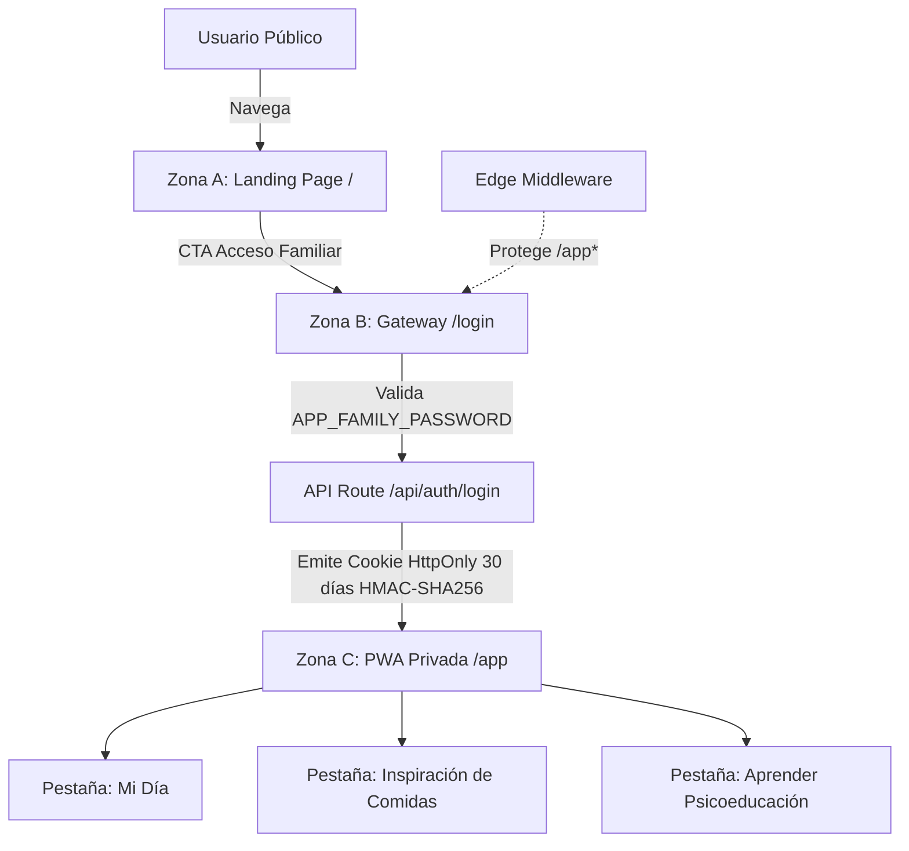

# NetAI • Plataforma de Bienestar y Nutrición Consciente

> **Enfoque Weight-Neutral & Anti-TCA** | Listo para Producción en **Vercel**

NetAI es una plataforma web integral de nutrición ética diseñada para erradicar la cultura de las dietas restrictivas y proteger la salud mental familiar. Cumple estrictamente con las **Guías Alimentarias para la Población Argentina (GAPA)** y los principios de **Alimentación Intuitiva**.

---

## 🏛️ Arquitectura del Sistema (3 Zonas Diferenciadas)



### 1. Zona A: Landing Page Comercial Pública (`/`)
- **Pública e indexable**: Diseñada para comunicar la propuesta de valor ético sin requerir registro.
- **Componentes**:
  - `Navbar`: Cabecera sticky con navegación y botón de acceso familiar.
  - `HeroSection`: Propuesta de valor, sellos de confianza y mockup realista de la PWA.
  - `FeaturesSection`: Los 4 pilares (Registro Consciente, Modo Intuitivo, Método del Plato, Evidencia GAPA).
  - `PhilosophySection`: Manifiesto Anti-Dieta y tabla comparativa vs. apps tradicionales punitivas.
  - `PricingSection`: Planes accesibles y transparentes (Mensual, Semestral, Familiar) sin cobros ocultos.
  - `PaymentMethodsSection`: Tarjetas, Mercado Pago, Transferencias y Cripto (USDT).
  - `Footer`: Links, contacto de soporte y **descargo de responsabilidad médica obligatorio**.

### 2. Zona B: Pasarela de Acceso Familiar (`/login` + Middleware)
- **Acceso por contraseña única familiar**: Sin registro individual complejo para evitar fricción familiar.
- **Seguridad**:
  - Comparación en tiempo constante (`timingSafeEqual`) contra `APP_FAMILY_PASSWORD` para mitigar ataques de temporización.
  - Generación de firma criptográfica `HMAC-SHA256` con Web Crypto API nativa en Node y Edge.
  - Cookie HttpOnly `netai_family_session` válida por 30 días (`maxAge: 2592000`).
  - Next.js Edge Middleware que intercepta cualquier intento de acceder a `/app*` sin sesión activa y redirige a `/login?redirect=...`.

### 3. Zona C: Progressive Web App Privada (`/app`)
- **Experiencia Nativa Móvil**:
  - Barra de navegación inferior fija (`pb-safe`) con 3 pestañas: **Mi Día**, **Inspiración de Comidas** y **Aprender**.
  - **Modo Bienestar / Intuitivo Global**: Oculta instantáneamente todos los números, calorías y métricas cuantitativas, sustituyéndolos por armonía de colores y grupos de alimentos.
  - **Piso Infranqueable Ético**: Límite inferior seguro de **1.500 kcal**; jamás permite metas restrictivas.
  - **Hidratación Consciente**: Registro de 8 vasos diarios basado en GAPA.
  - **Escala de Saciedad (1 al 10)**: Registro de autopercepción de hambre antes y plenitud después de comer.
  - **Inspiración de Recetas**: Catálogo curado con proporciones de Harvard/GAPA (50% vegetales, 25% proteínas, 25% granos) y botón directo "Sumar a mi día".
  - **Persistencia Local y Privada**: Guarda los datos en `localStorage` del dispositivo sin enviar registros íntimos a servidores externos.

---

## 🌿 Reglas Éticas de UX Writing y Diseño Anti-TCA

| Concepto Prohibido | Sustituto Ético en NetAI |
| :--- | :--- |
| "Bajar de peso", "adelgazar", "quemar grasa" | **Bienestar diario, vitalidad y salud integral** |
| "Comida trampa" (cheat meal) | **Alimentos de consumo ocasional** |
| "Alimentos buenos / malos" | **Nutrientes de consumo habitual vs. recreativos** |
| "Calorías excedidas", "meta fallada" | **Balance de energía flexible, autorregulación semanal** |
| Alertas punitivas rojas (`#EF4444`) | **Paleta serena: Salvia (`#4A6B53`), Tierra (`#9C7A5B`) y Océano** |

---

## 🚀 Despliegue en Vercel (Guía de 5 Minutos)

### Paso 1: Subir el repositorio a GitHub / GitLab
```bash
git add .
git commit -m "feat: plataforma de bienestar y nutrición consciente NetAI completa"
git push origin main
```

### Paso 2: Importar en Vercel
1. Ingresá a [vercel.com](https://vercel.com) e iniciá sesión con tu cuenta.
2. Hacé clic en **"Add New..."** > **"Project"**.
3. Seleccioná el repositorio `netAI`.
4. El framework se detectará automáticamente como **Next.js**.

### Paso 3: Configurar Variables de Entorno
En la sección **"Environment Variables"** del panel de Vercel, agregá las siguientes dos variables:

| Variable | Valor Recomendado | Descripción |
| :--- | :--- | :--- |
| `APP_FAMILY_PASSWORD` | Tu contraseña secreta familiar (ej: `familia2026`) | Clave única de acceso para la Zona B |
| `SESSION_SECRET` | Clave aleatoria de al menos 32 caracteres | Clave de firma para las cookies HMAC-SHA256 |

> **Tip para generar `SESSION_SECRET`**:
> Podés generar una clave segura abriendo tu terminal y ejecutando:
> ```bash
> openssl rand -base64 32
> ```

### Paso 4: Deploy
Hacé clic en **"Deploy"**. En menos de 2 minutos tu sitio estará activo con HTTPS automático, Edge Middleware global y soporte PWA offline.

---

## 💻 Desarrollo Local

```bash
# 1. Instalar dependencias
npm install

# 2. Iniciar servidor de desarrollo
npm run dev

# 3. Compilar bundle de producción
npm run build

# 4. Iniciar servidor de producción local
npm start
```

Abrí [http://localhost:3000](http://localhost:3000) en tu navegador para ver la Landing Page o ingresá con la contraseña `familia2026` en `/login`.
