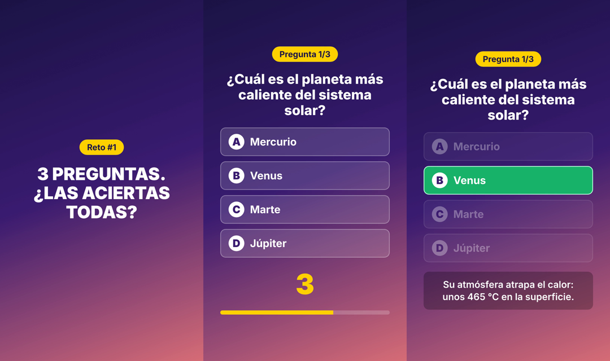

# Shorts automáticos de preguntas (quiz)

Cada día genera un Short vertical de unos 35-45 segundos con un reto de **3 preguntas** de cultura general, narrado con voz de **ElevenLabs**, y lo sube a YouTube.



**Estructura del vídeo:**
1. Gancho narrado ("¡Tres preguntas! Casi nadie acierta las tres…").
2. Por cada pregunta: la voz la lee, cuenta atrás de 3 s con tic-tac y campana al revelar la respuesta con un dato curioso.
3. Cierre: "¿Cuántas acertaste? Dímelo en los comentarios…".

Cada escena dura lo que tarda la voz en leerla. Para cambiar el número de preguntas, usa la variable `PREGUNTAS_POR_VIDEO` (3 por defecto).

## Voz con ElevenLabs

1. Crea una cuenta en [elevenlabs.io](https://elevenlabs.io) y copia tu API key en *Profile → API Keys*.
2. Guárdala en GitHub como secreto `ELEVENLABS_API_KEY`.
3. (Opcional) Elige una voz nativa en español en la *Voice Library*, copia su Voice ID y créalo como **variable** de Actions `ELEVENLABS_VOICE_ID`. Si no, se usa una voz predefinida (Adam) con el modelo multilingüe. Las voces de la biblioteca solo se pueden usar por API con un plan de pago.

Cada vídeo consume unos 500-700 caracteres. El plan gratuito (10.000 caracteres al mes) da para unos 15 vídeos al mes, así que para publicar a diario hace falta el plan Starter. El plan gratuito tampoco permite el uso comercial, y para monetizar el canal necesitas un plan de pago.

Sin `ELEVENLABS_API_KEY`, el vídeo se genera igual pero sin narración, solo con los efectos de sonido.

## Archivos

| Archivo | Para qué sirve |
|---|---|
| `preguntas.json` | Banco de preguntas (30 = 10 vídeos). Añade más para tener más días de contenido |
| `estado.json` | Índice de la primera pregunta del siguiente vídeo |
| `render.js` | Pasa HTML a imágenes con Playwright y las convierte en MP4 con ffmpeg |
| `voz.js` | Narración con ElevenLabs y efectos de sonido (tic y campana) |
| `upload.js` | Sube el vídeo con la YouTube Data API v3 |
| `auth.js` | Se ejecuta una sola vez para obtener el refresh token |
| `publicar.js` | Genera la siguiente pregunta y la sube |
| `musica.mp3` (opcional) | Si existe, se usa como música de fondo. Usa solo música libre de derechos, por ejemplo de la Biblioteca de audio de YouTube |

## Probar en local

```bash
cd youtube-shorts
npm install
DRY_RUN=1 node publicar.js   # genera out/short-N.mp4 sin subirlo
node render.js 2             # renderiza el reto 3 (preguntas 7 a 9)
ELEVENLABS_API_KEY=xxx DRY_RUN=1 node publicar.js   # igual, con voz
```

## Configurar la subida a YouTube

1. En [Google Cloud Console](https://console.cloud.google.com/), crea un proyecto y activa **YouTube Data API v3**.
2. Configura la **pantalla de consentimiento OAuth** de tipo externo y añade tu cuenta como usuario de prueba.
3. Crea unas **credenciales OAuth** de tipo *Aplicación de escritorio* y copia el Client ID y el Client Secret.
4. En tu ordenador, ejecuta:
   ```bash
   YT_CLIENT_ID=xxx YT_CLIENT_SECRET=yyy node auth.js
   ```
   Abre la URL que aparece, inicia sesión con la cuenta del canal y copia el `YT_REFRESH_TOKEN`.
5. En GitHub, ve a **Settings → Secrets and variables → Actions** y crea estos secretos: `YT_CLIENT_ID`, `YT_CLIENT_SECRET` y `YT_REFRESH_TOKEN`.
6. Para probarlo, ve a la pestaña **Actions**, elige "Publicar Short diario" y pulsa **Run workflow**.

### Avisos importantes

- **Privacidad:** los vídeos se suben como `private` por defecto. Mientras la app de Google Cloud no pase la verificación de la API de YouTube, Google los bloquea en privado aunque pidas `public`. Cuando la app esté verificada, crea la variable de Actions `YT_PRIVACY=public`.
- **Token caducado:** con la pantalla de consentimiento en modo "Testing", el refresh token caduca a los 7 días. Para que no caduque, pon la app en "In production".
- **Cuota:** cada subida gasta unas 1.600 de las 10.000 unidades diarias de la API.
- **Monetización:** YouTube no monetiza el contenido repetitivo. Varía las preguntas, los ganchos y los temas.
